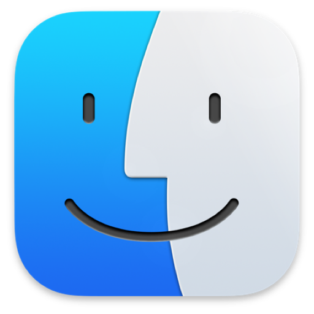

<p align="center">
  
</p>

# apple-vision-mcp

A local MCP server, written in Swift, exposing OCR and barcode reading to Claude through `Vision`. It ships
as a Claude extension.

No Finder, no Apple events, no network. Everything is a direct `Vision` call, gated by
one allow-list of folders chosen when the extension is installed. Nothing outside it is
reachable, by any tool.

Not affiliated with or endorsed by Apple Inc.

## Requirements

- macOS 26 or later
- Swift 6.0 or later (Xcode 26 ships it)
- A code signing identity. Ad-hoc works, but every rebuild then asks for permission
  again — see [Signing](#signing-and-why-it-is-not-optional).

## Tools

| Tool | Kind | What it does |
|---|---|---|
| `vision_status` | read | Reports the read scope, a page of folders at a time, and whether macOS is actually letting this process reach it. Reads no file contents. |
| `vision_ocr` | read | Runs Vision's text recognition over an image or PDF pages, rendering each page first. Returns whole pages up to about one result; `first_page` and `last_page` choose pages, `character_offset` and `max_characters` read one page that is longer. |
| `vision_barcodes` | read | Runs Vision's barcode detection over an image or a PDF, rendering each page first. Returns the codes found a page at a time (`limit`, `offset`), ordered by page, then top to bottom, then left to right, each with its symbology, decoded payload and pixel box. |

## Bounds

**Every result is bounded, and says what it left out.** `vision_ocr` returns whole pages
until their text reaches about one usual result, never more pages than one call may read.
`vision_barcodes` scans a bounded number of pages and returns its codes a page at a time.
`vision_status` lists the configured folders a page at a time. When a result does not hold
everything, its first lines say how much there is and the exact arguments that return the
rest: `first_page` and `last_page` for pages, `limit` and `offset` for codes and folders,
`character_offset` and `max_characters` for one page whose text is longer than a result. A
number outside its range is moved to the nearest allowed value and the first lines say which
was used; a `last_page` before `first_page`, an argument a tool does not have and a value of
the wrong type are refused. The sizes are constants in `ToolCatalog.swift`, which the schemas,
descriptions and instructions quote. No result is longer than `ToolStandard.longestResult`:
each tool keeps to that itself, and the protocol layer cuts, with a notice, any result that
did not.

**What a deadline can and cannot stop.** Recognising a page takes seconds. The time is
checked between pages: once the recognition budget is spent no further page is started and
the call returns what it has, marked partial. A call that has not finished by its hard
deadline is abandoned and answered with an error. Neither can interrupt a Vision request that
is already running: it finishes in the background, its result is discarded, and no further
page of that call is started. The file is only read, so nothing is changed either way. Both
times are constants on `VisionTools`.

## Frameworks and APIs

| Used | For | Reference |
|---|---|---|
| Vision — `VNRecognizeTextRequest`, `VNImageRequestHandler`, `VNRecognizedTextObservation` | The recognition itself, at `.accurate` with language correction on | [Vision](https://developer.apple.com/documentation/vision) |
| Vision — `VNDetectBarcodesRequest`, `VNBarcodeObservation` | Barcode and QR detection over every symbology Vision supports; payload, symbology and bounding box | [VNDetectBarcodesRequest](https://developer.apple.com/documentation/vision/vndetectbarcodesrequest) |
| PDFKit — `PDFDocument`, `PDFPage.draw(with:to:)` | Rasterising a PDF page. Nothing else: no text, outline or metadata is ever read | [PDFKit](https://developer.apple.com/documentation/pdfkit) |
| Image I/O — `CGImageSourceCreateWithURL` | Loading an image file | [Image I/O](https://developer.apple.com/documentation/imageio) |
| Core Graphics — `CGContext`, `CGColorSpace` | The bitmap a PDF page is drawn into | [Core Graphics](https://developer.apple.com/documentation/coregraphics) |

Vision ships dozens of request classes; this server uses two. Document segmentation, face
and body analysis, image classification, saliency, feature prints and all tracking and
registration are available in the framework and deliberately not wired up. The
newer Swift-only Vision API (`RecognizeTextRequest`, `RecognizeDocumentsRequest`) is not used
either — this is the Objective-C `VN*` API.

## The rules worth knowing before you use it

**Canonicalise first, then compare — the order is not negotiable.** Every path is
resolved before it is checked: `~` expanded, `..` removed, symlinks followed. Comparing
the raw string first would let `~/Documents/../../../etc` and a symlink pointing out of
the tree both pass a prefix test while landing somewhere else entirely. The configured
roots are canonicalised the same way, because `/tmp` is itself a symlink to
`/private/tmp` — a root compared raw would reject every path that resolved through it.
Containment is checked by path component, not string prefix, so `Documents-private` is
never mistaken for something inside `Documents`.

**PDFKit here is a rasterizer, nothing more.** For a PDF, `vision_ocr` renders each page
to a bitmap and runs Vision over the pixels — it never reads the PDF's own text, outline
or metadata. That line is deliberate: a PDF that
already has a text layer should have it read directly, which is faster and more accurate than
recognising pixels. This server is for the scan that has no text layer.

**This server has no write of any kind.** It only ever opens a file and reads it.

**OCR is slower and less accurate than a real text layer.** Recognition is Vision's, with
language correction on; the top candidate per line is kept, and the lines come back in the
order Vision found them — this server does no reordering of its own.

## Install

### 1. Build the bundle

```bash
security find-identity -v -p codesigning   # copy the 40-character hash of an Apple Development or Developer ID Application identity
MCPB_SIGN_IDENTITY="<identity hash>" ./scripts/pack.sh
```

Pass the hash, not the certificate's name: `pack.sh` prints the identity it signs with,
and the name is yours.

That builds an arm64 (Apple silicon only) release binary, signs it, checks the embedded
`Info.plist` survived both linking and signing, prints the designated requirement, and
writes `dist/apple-vision-mcp.mcpb`. It fails loudly rather than shipping a bundle that
would silently refuse to work.

### 2. Install it

Open `dist/apple-vision-mcp.mcpb` with Claude. Then **quit Claude Desktop completely and
reopen it** — reinstalling does not replace a server process that is already running,
and the old one keeps answering.

### 3. Configure the read scope

This server is the deliberate exception to "nothing to configure":
`read_roots` is not a preference with a sensible default, it
is the security boundary itself. In Claude Desktop → Settings → Extensions → Vision, set
**Folders Claude may read** — Claude can run OCR and read barcodes on anything inside these; nothing
outside them is reachable at all. There is no hardcoded fallback like `~/Documents` — an
unconfigured install reaches nothing, deliberately, rather than reaching folders nobody
chose.

### 4. Grant the permission

The first call that touches a folder raises the macOS consent dialog for it, one dialog
per top-level location, under System Settings → Privacy & Security → Files and Folders
(Spanish UI: Ajustes del Sistema → Privacidad y seguridad → Archivos y carpetas). The
embedded `Info.plist` declares separate usage descriptions for Desktop, Documents,
Downloads, removable volumes and network volumes — a read root anywhere else (iCloud
Drive, an external disk, `~/Code`) falls under **Full Disk Access** instead, which has
no per-folder prompt and has to be granted by hand.

A root that is configured but never actually reached will not prompt. `vision_status`
probes every configured root and reports what it found.

If no dialog ever appears:

```bash
otool -P extension/server/apple-vision-mcp | grep UsageDescription
```

### Signing, and why it is not optional

`swift build` leaves a signature the linker generated, flagged `linker-signed`. macOS
treats that as signed by nobody: it produces **no designated requirement**, so there is
nothing to anchor a permission to except the binary's cdhash — and every rebuild changes
that. Worse, a linker-signed binary never gets a consent dialog at all; the request
returns with the status still "not determined".

Signing with a real certificate produces a requirement anchored to the bundle identifier
and the certificate instead:

```
designated => identifier "codes.eneko.apple-vision-mcp" and anchor apple generic
              and certificate leaf[subject.CN] = "Apple Development: …"
```

That survives rebuilds. `pack.sh` prints the requirement on every build, so a silent
regression to ad-hoc is visible immediately.

**Changing certificate re-prompts once.** The requirement quotes the certificate, so
moving between ad-hoc, Apple Development and Developer ID each costs one fresh round of
consent.

### Preparing something to distribute

```bash
MCPB_HARDENED=1 MCPB_SIGN_IDENTITY="<Developer ID Application hash>" ./scripts/pack.sh
```

That adds the hardened runtime and a secure timestamp, which notarisation requires. This
server sends no Apple events and needs no entitlements file to go with it.

## Tool switches

Both tools can be turned on and off individually in Claude Desktop, because the bundle
declares them in its manifest — that is where policy lives, not in this code.

**Reinstalling may reset the switches.** Check them after every install.

## Manual registration instead

```json
{
  "mcpServers": {
    "Vision": {
      "command": "/absolute/path/to/apple-vision-mcp/.build/release/apple-vision-mcp",
      "args": ["--read-roots", "/Users/you/Documents"]
    }
  }
}
```

You lose the per-tool switches, and the read scope must be passed as an argument by hand
since there is no `user_config` to fill it in for you.

## Known limits

- **No PDF text, outline or metadata.** `vision_ocr` only ever rasterizes a PDF page to
  pixels. A PDF's own text layer is not read here at all.
- **A payload is data, not a command.** The text inside a QR code is whatever its author
  put there. It is returned as text and nothing here opens a link it holds.
- **Vision's recognition is what it is.** The request runs with language correction on and
  keeps the top candidate per line; beyond that this server does no reordering and no
  confidence filtering.

## Development

```bash
swift build
swift test
```

The scope and catalogue tests run against a modelled store that throws from every method
except `canonicalise`, so a scope test that accidentally reached a real file fails loudly
rather than quietly passing. The barcode detection tests draw their own QR codes and
barcodes with Core Image into a directory they create under `$TMPDIR` and remove before
they return. See
`CLAUDE.md`, whose first section is the hard rule that makes that non-negotiable: no
agent working in this repository may touch a file outside it.

Manual verification against real files is the owner's job, by hand, with MCP Inspector.

## Licence

MIT.
